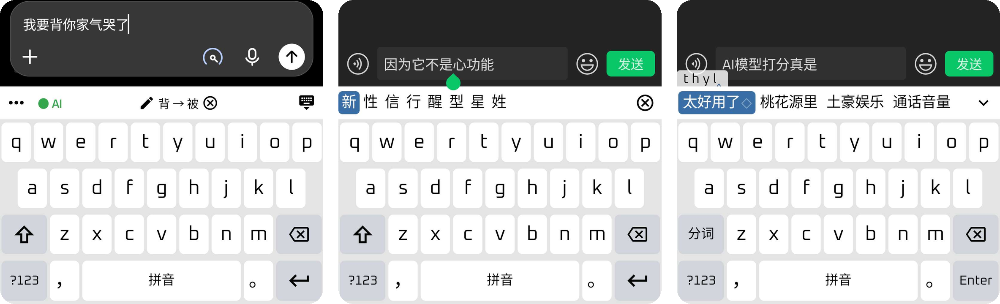

<h1 align="center">rime-suzu</h1>

<p align="center">
  集成本地 AI 小模型的 Rime 拼音配置：按上文重排候选、补充简拼候选，支持鼠须管（macOS）、小狼毫（Windows）和同文输入法 Trime（Android）。<br>
  方案基于 <a href="https://github.com/iDvel/rime-ice">雾凇拼音（rime-ice）</a>，词库以“词库包”的形式安装，支持雾凇和白霜，可随时切换。
</p>

<p align="center">
  <br>
  <sub>Android（Trime）预览：GBoard 风格布局。左：打完后面的字，工具栏提示把选错的“背”改成“被”。中：光标点到“心”上，候选栏按整句分列出同音字。右：简拼 <code>thyl</code> 按上文排出“太好用了”，<code>◇</code> 表示模型参与了这次排序。</sub>
</p>

---

## 安装

| 平台 | 安装方式 |
|---|---|
| macOS（Apple 芯片，macOS 13 及以上） | 先装好[鼠须管](https://github.com/rime/squirrel/releases)，再运行下面的一行命令 |
| Windows（小狼毫 0.17） | 在 PowerShell 中运行下面的一行命令 |
| Android（arm64，Android 11 及以上） | 从 [suzu-ime 发布页](https://github.com/1zumiii/suzu-ime/releases/latest) 下载 APK，启用步骤见 [suzu-ime](https://github.com/1zumiii/suzu-ime#android) |

macOS：

```bash
curl -fsSL https://raw.githubusercontent.com/1zumiii/rime-suzu/main/install.sh | bash
```

Windows：

```powershell
irm https://raw.githubusercontent.com/1zumiii/rime-suzu/main/install.ps1 | iex
```

安装包含编译好的推理核心、模型、配置和词库，无需 git 或自行编译。脚本先列出要做的事并请求确认，再下载、核对 sha256、备份并安装。已装过旧版的，重新运行同一条命令即可升级。

安装包自带 Suzu-UER6-PG200。电脑性能较好时，可以改装准确率更高的 Suzu-UER12-PG100，每次打分的耗时约为前者的两倍。安装时从 Hugging Face 下载并核对 sha256，首位门控随模型设置：

```bash
curl -fsSL https://raw.githubusercontent.com/1zumiii/rime-suzu/main/install.sh | bash -s -- macos --model PG100
```

```powershell
$env:SUZU_MODEL = 'PG100'; irm https://raw.githubusercontent.com/1zumiii/rime-suzu/main/install.ps1 | iex
```

可选的模型见 [模型列表](https://github.com/1zumiii/suzu-ime/blob/main/models.json)，macOS 加 `--list-models` 也可列出。

- 恢复：安装前的用户目录备份在 `~/Library/Rime.backup-时间`（Windows 为用户目录名加 `.backup-时间`），改回原名即可恢复。`rime_ice.custom.yaml` 会换成本项目的版本，改过的设置在备份里。
- 使用：桌面端默认开启 AI 重排，`Control+Shift+5` 在当前输入框临时切换。候选后带 `◇` 表示模型参与了这次排序。macOS 读取光标前的文字需要在“系统设置 → 隐私与安全性 → 辅助功能”中允许鼠须管。
- 隐私：开发用的输入日志默认关闭。最近用过的词、词对等个人习惯以明文保存在本机用户目录，可随时删除，见 [其他功能](docs/features.md)。

已有自己的 Rime 方案、只想接入 AI 重排的，见 [接入已有的 Rime 配置](https://github.com/1zumiii/suzu-ime#接入已有的-rime-配置)。版本与下载文件见 [发布页](https://github.com/1zumiii/rime-suzu/releases/latest)。

## 效果

默认模型为 [Suzu-UER6-PG200](https://huggingface.co/IzumiThe3rd/Suzu-UER6-PG200)，可选 [Suzu-UER12-PG100](https://huggingface.co/IzumiThe3rd/Suzu-UER12-PG100)。在鼠须管的 librime 中逐键输入两字母简拼的题目，题目取自知乎、天涯和清华树洞，按帖子划分出验证集，答案为原文里的词。首位门控都是 1.5：

| 设置 | 题数 | 首选 | 改动首位 | 其中改错 |
|---|---:|---:|---:|---:|
| 不用模型分（同一批候选按 Rime 原名次排序） | 1,195 | 28.5% | | |
| Suzu-UER6-KD500（上一版） | 1,190 | 54.0% | 547 | 12 |
| Suzu-UER6-PG200（默认） | 1,195 | **56.4%** | 632 | 18 |
| Suzu-UER12-PG100（可选） | 1,190 | **58.2%** | 638 | 14 |

三个模型的验证集按同一规则划分，题数略有差别，不是逐题配对。“改错”指原本正确的首选被模型换掉。全拼同音词 1,293 题上，PG200 为 93.43%，PG100 为 93.50%，上一版 KD500 为 92.81%。

推理在本机运行，输入内容不出设备。PG200 的模型文件约 52.8 MB，PG100 约 98.2 MB。手机上（ASUS Zenfone 10，守护进程 2 线程，每组 10 个候选），PG200 打分加候选生成的 P99 约 20 ms，常驻内存约 150 MiB。PG100 每次打分的耗时约为 PG200 的两倍，在这台手机上连续输入时约 12% 的请求超过 45 ms 时限，所以手机默认用 PG200。

## 功能

- AI 重排：本地小模型 [Suzu](https://github.com/1zumiii/Suzu) 按上文为候选打分，调整顺序。四字及以上的输入另有第二阶段。
- 候选生成：简拼和混合输入时，从词典中按上文筛选 Rime 未给出的词，补充到候选窗。
- 统一排序：总分 = Rime 名次先验 + 上文权重 × 模型分 + 个人习惯，关闭 AI 时上文权重为 0。
- 个人词对与最近使用优先：同样的搭配再次出现时优先，最近上屏过的词提升到第 2 位。记录只保存在本机。
- 语法模型、模糊音与误触容错：配置万象语法模型，开启平翘舌与前后鼻音模糊音。相邻按键误触仅处理 4 个字母及以上的音节。
- 选错修正（Android）：停顿后检查句中刚选过的词。换成同页的同音候选后整句更通顺时，工具栏提示“A → B”，点按才替换。光标点到文字上时，候选栏列出可替换的同音候选，点选后只替换对应片段。
- Android 手机端：改版 Trime 采用 GBoard 风格布局，推理在常驻进程 `rimellmd` 中运行。工具栏提供 AI 状态徽标，“设置 → AI 与输入辅助”可单独开关各项功能。

## 平台

| 平台 | 前端 |
|---|---|
| macOS | 鼠须管 |
| Windows | 小狼毫 0.17 |
| Android | 改版同文输入法（Trime） |

AI 重排的推理核心、守护进程和改版 Trime 的源码位于 [suzu-ime](https://github.com/1zumiii/suzu-ime) 仓库，本仓库只保留配置和同步的 Lua 脚本。没有模型文件时不重排，输入不受影响。

## 从源码安装

开发者可从源码安装，并自行编译推理核心：

```bash
git clone https://github.com/1zumiii/rime-suzu.git
cd rime-suzu
tools/install-dev.sh                 # 安装配置和词库包（首次需要联网下载词库）
tools/install-dev.sh --pack frost    # 换用其他词库包，见 docs/dictionary-packs.md
```

下载 [Suzu-UER6-PG200](https://huggingface.co/IzumiThe3rd/Suzu-UER6-PG200) 或 [Suzu-UER12-PG100](https://huggingface.co/IzumiThe3rd/Suzu-UER12-PG100) 的 GGUF 权重和配套词表，分别保存为 `suzu.gguf` 和 `suzu.vocab.txt`。按 [suzu-ime 的 macOS 说明](https://github.com/1zumiii/suzu-ime/blob/main/macos/README.md) 编译并安装推理核心 `rime_llm.so`，再重启输入法。Windows 与 Android 的步骤见 [安装](docs/install.md)。

## 文档

| 文档 | 内容 |
|---|---|
| [AI 重排](docs/ai-rerank.md) | 模型与性能、使用方法、上文与隐私、候选生成与统一排序、置信度门控 |
| [Android](docs/android.md) | 改版 Trime、AI 服务、配置更新、功能状态页、手机端设置 |
| [其他功能](docs/features.md) | 个人词对、最近使用优先、本机记录一览、选词统计、语法模型、模糊音、小改动 |
| [安装](docs/install.md) | macOS、Windows、Android 的完整安装步骤 |
| [词库包](docs/dictionary-packs.md) | 词库不放在仓库里：安装与替换词库、新增词库包、本仓库的补充词条 |
| [设置页](docs/settings.md) | macOS 与 Windows 的网页设置：排序参数、候选映射、词库包切换、一键重新部署 |
| [维护说明](docs/maintenance.md) | 补丁与部署的注意事项、与雾凇上游的关系、自定义内容的位置 |
| [误触容错](docs/typo-tolerance.md) | 相邻按键误触的数据与取舍 |

## 项目说明

本仓库的方案文件与配置结构来自 [iDvel/rime-ice](https://github.com/iDvel/rime-ice) 的 `da1fbe6`（2026-10-05），此后独立维护，不再定期合并上游。上游重要的 Lua 或方案修复按需摘取。

仓库保留配置、Lua 脚本和各端部署脚本，不含词库。词库按在线名录登记的固定提交安装，离线时使用 `packs/packs.tsv`。当前支持雾凇和白霜，安装和更换方法见 [词库包](docs/dictionary-packs.md)。个人改动放在独立文件中，包括 `*.custom.yaml` 补丁和 Lua 脚本。补充词条放在 `extras/extra.dict.yaml`，可叠加到任何词库包上。

## 致谢与许可

感谢 [iDvel/rime-ice](https://github.com/iDvel/rime-ice) 及其贡献者、[gaboolic/rime-frost](https://github.com/gaboolic/rime-frost)（白霜拼音词库，GPL-3.0，词库包之一）、[zhanghaozhecn/rime-llm-rerank](https://github.com/zhanghaozhecn/rime-llm-rerank)（AI 重排的原项目，署名许可，个人使用无限制）、[amzxyz/rime-wanxiang-data](https://github.com/amzxyz/rime-wanxiang-data)（万象语法模型，CC BY 4.0）、[llama.cpp](https://github.com/ggml-org/llama.cpp)、[osfans/trime](https://github.com/osfans/trime)（同文输入法，GPL-3.0）及同文风主题作者暖暖、[Shizuku](https://github.com/RikkaApps/Shizuku)，以及 Rime、librime-lua、librime-octagram 的作者。

本仓库沿用雾凇的 GPL-3.0 许可证，见 [LICENSE](LICENSE)。词库包、模型文件和语法模型各自遵循发布方的许可，来源与许可证登记在 `packs/packs.tsv`。
